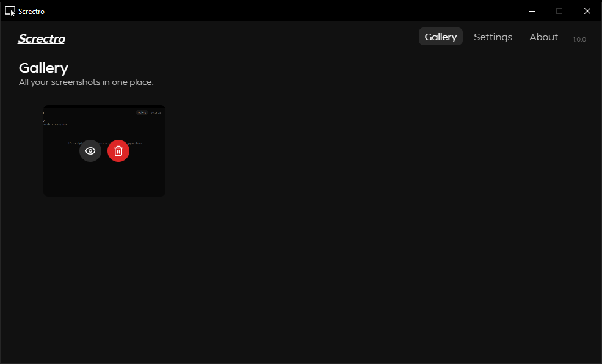
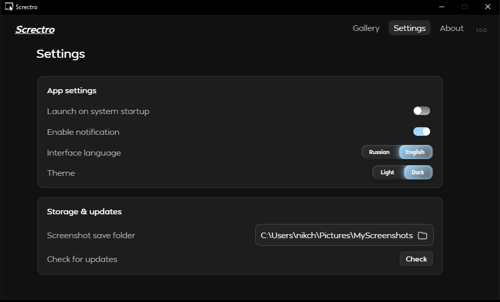

# Screctro

Desktop screenshot application built with Electron, React, and TypeScript.

## Features

- Area screenshot capture
- Fullscreen screenshot capture
- Multi-monitor support
- Screenshot gallery
- Open screenshots directly from the app
- Delete screenshots
- Custom save directory
- Language switching:
  - Russian
  - English
- Theme support:
  - Light theme
  - Dark theme
- Auto-start on system boot
- Notifications toggle
- Application updates support

## Tech Stack

- TypeScript
- Electron
- React

## Screenshots




---

## Installation

### Clone repository

```bash
git clone <your-repository-url>
cd screctro
```

### Install dependencies

```bash
npm install
```

### Run in development mode

```bash
npm run dev
```

### Build application

```bash
npm run build
```

## Settings

The application supports:
- Save folder selection
- UI language switching
- Theme customization
- Notifications enable/disable
- Auto-launch configuration
- Automatic update handling

## License

This project is proprietary software.

Usage is allowed only for personal, non-commercial purposes and only through the official GitHub repository.

See the LICENSE file for details.
